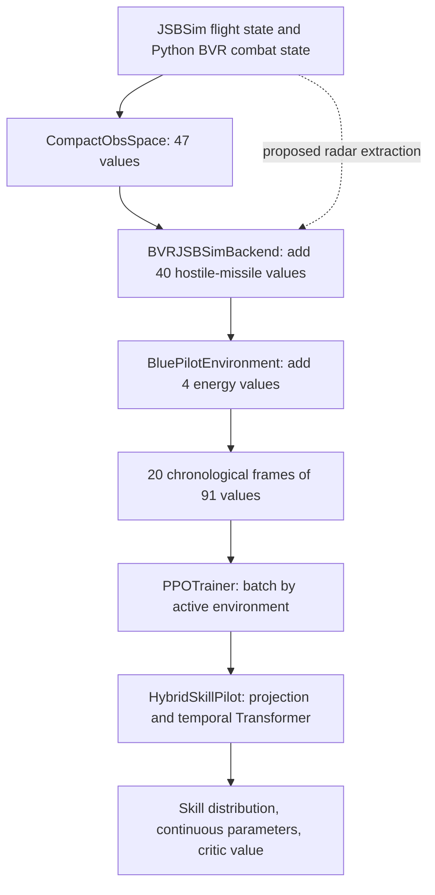

**Notebook 30 currently supplies 91 features per frame to each pilot, and the backend contains enough information to add radar context.** I pulled `simplifed_training_environment_261111` and reviewed implementation commit `7302daffcb490569f9f07bf46c78246a78a6f565`. That includes the hostile-missile extension made after the original question. The historical 51-feature description therefore needs updating. All source links below are pinned to this implementation commit.

The radar integration described below is a design proposal. This document does not claim that those additional radar features have already been implemented. The existing 91-feature input, its tests, and its checkpoint behavior are implemented.

| Input contract | Backend frame | Energy features added by wrapper | Final policy frame |
| --- | ---: | ---: | ---: |
| Legacy/default backend | 47 | 4 | 51 |
| Notebook 30 now: `include_hostile_missiles=True` | 87 | 4 | 91 |
| Concrete radar extension proposed here | 111 | 4 | 115 |

**Observation construction is distributed across the simulator, adapter, environment wrapper, and trainer.** `HybridSkillPilot` consumes the resulting tensor; it does not query JSBSim or assemble its own sensor measurements.

| Repository location | Responsibility |
| --- | --- |
| [Notebook 30][notebook], zero-based JSON cells 4 and 7 | Builds the backend/environment factory, enables hostile missiles, selects the frame size, and configures sampling/history/planning |
| [Python aircraft factory][factory] | Selects `JSBSimFDM` and attaches radar, RWR, MWS, and SA datalink sensors to each F-16 |
| [`bvr_env.py`][env] | Resets and advances the Python simulator; `_get_obs()` calls the observation extractor and `_pack_obs()` selects controlled agents |
| [`src_py/observation_space.py`][compact] | `CompactObsSpace.extract_obs()` builds the original 47 values |
| [`rl/bvr_jsbsim_backend.py`][backend] | Flattens that vector; `_policy_observation()` optionally adds 40 incoming-missile values; `_aircraft_info()` supplies reward/diagnostic state |
| [`rl/environment.py`][wrapper] | Adds four energy values and maintains the chronological history |
| [`rl/simulation_workers.py`][workers] | Runs environment reset/step calls in workers; sends numeric observations/actions across process boundaries |
| [`rl/trainer.py`][trainer] | Batches histories, collects on-policy experience, and prepares PPO minibatches |
| [`rl/pilot.py`][pilot] | Projects each frame into temporal Transformer tokens and predicts skills, parameters, and value |
| [`rl/multi_pilot.py`][population] | Constructs independent pilots, applies sampled configurations, and saves/loads checkpoint metadata |



Notebook 30 instantiates `BVR3DEnv`, the Python simulator using `src_py`, rather than `BVR3DEnvCpp`. JSBSim supplies aircraft flight dynamics; Python BVR code supplies sensors, weapons, opponents, and engagement logic. The similarly named C++ radar/sensor-manager implementation is outside this notebook's execution path. C++ support would require a separate implementation and parity tests if it were later selected.

There is also an explicit team-name reversal in the adapter:

| Training-facing role | Simulator identity |
| --- | --- |
| Controlled “blue” pilot | `A01`, internally Red |
| Opponent “red” aircraft | `B01`, internally Blue |

Features should be defined in terms of *observer* and *target*, not inferred from a string such as `blue`. This becomes essential when recording observations from both sides in a duel.

The adapter fixes simulator `dt` at 0.1 seconds, requests `obs_type="compact"`, creates one F-16 per side, and uses the simple scripted opponent by default. It passes scenario range as initial horizontal separation and the two scenario altitudes as an altitude sampling interval. It does not pass every scenario field through: the Python reset samples its engagement axis, starts both aircraft at 300 m/s facing each other, and samples actual altitudes within the interval. Recorded actual state, rather than the scenario dataclass alone, is authoritative for interpreting an observation.

**The exact current frame is 47 compact values, 40 hostile-missile values, then four energies.** All indices below are zero-based. Position/velocity axes are world North, West, Up (NWU). Relative quantities mean other object minus observer.

| Indices | Actual feature values | Normalization |
| --- | --- | --- |
| 0–2 | Own north, west, up position | Horizontal / 50,000 m; vertical / 10,000 m |
| 3–5 | Own NWU velocity | / 600 m/s |
| 6 | Own altitude | / 10,000 m |
| 7–8 | Sine/cosine of own heading | Dimensionless |
| 9–11 | Enemy relative NWU position | Horizontal / 50,000 m; vertical / 10,000 m |
| 12–14 | Enemy relative NWU velocity | / 600 m/s |
| 15 | Three-dimensional enemy range | / 50,000 m |
| 16–17 | Sine/cosine of horizontal enemy bearing relative to own heading | Dimensionless |
| 18 | Whether a live hostile missile targets the observer | 0 or 1 |
| 19–46 | Four friendly missile slots, seven values each | See below |
| 47–86 | Four incoming hostile missile slots, ten values each | See below |
| 87 | Own normalized specific kinetic energy | `(own_speed / 400)²` |
| 88 | Own normalized specific potential energy | `own_altitude / 12,000` |
| 89 | Opponent normalized specific kinetic energy | `(opponent_speed / 400)²` |
| 90 | Opponent normalized specific potential energy | `opponent_altitude / 12,000` |

Each friendly slot contains relative position (three values), relative velocity (three), and range (one). Position/range scales are 50,000 m horizontally/radially and 10,000 m vertically; missile relative velocity is divided by 1,200 m/s. The extractor selects live same-team missiles in dictionary iteration order, takes the first four, and zero-fills unused slots. These friendly slots are not sorted nearest first and have no explicit presence flag.

Each new hostile slot contains the following, starting at `47 + 10*i` for slot `i`:

| Offset | Feature | Normalization |
| --- | --- | --- |
| 0 | Presence | 1 for a populated slot, 0 for padding |
| 1–3 | Relative NWU position | / 50,000, / 50,000, / 10,000 m |
| 4–6 | Relative NWU velocity | / 1,200 m/s |
| 7 | Three-dimensional range | / 50,000 m |
| 8 | Signed closing speed | / 1,200 m/s; positive when approaching |
| 9 | Missile seeker active, `radar_on` | 0 or 1 |

Only live hostile missiles whose `target is controlled` are selected from `under_missiles`. They are sorted by current range, then UID for deterministic ties, and limited to four. Resolved entries are excluded even though the list retains historical missiles. Slot identity can change as missiles cross in range; there is no explicit identity channel. UIDs determine tie-breaking but are not neural inputs.

For relative position `r` and relative velocity `v`, closing speed is `-dot(r, v) / norm(r)`, with zero returned at zero range. This is a range rate, not a time-to-impact prediction. Divisors scale values without clipping: a normalized speed or position can exceed one.

The compact extractor returns zeros for a dead observer and zero-fills a dead enemy's block. The hostile extension also returns zero hostile slots when the observer is dead. The final energy values are calculated separately and need not all be zero on that terminal frame. The compact class's descriptive comment is outdated: indices 7–8 are heading sine/cosine, and a calculated vertical bearing is not appended.

Most importantly, enemy position/velocity, the original incoming-threat flag, the new hostile-missile geometry/seeker state, and opponent energy all use **simulator truth**. Radar detection does not gate them. A missile can appear in the new slots before its seeker activates and regardless of MWS output. This is a deliberate description of the current contract, not a claim of realistic onboard observability.

**The wrapper provides temporal context at 10 Hz, while the policy chooses a skill at 1 Hz.** In notebook 30, `history_duration_s=2.0`, `sample_interval_s=0.1`, and `planning_horizon_s=1.0`. `BluePilotEnvironment` therefore keeps 20 frames and applies each selected skill over up to ten backend steps before requesting the next decision.

On reset, the initial frame is copied into all 20 history positions. There is no separate validity mask for this padding. Subsequently, every backend step adds a fresh frame, dropping the oldest. Histories are oldest-to-newest. Twenty samples spaced 0.1 seconds apart span 1.9 seconds between the oldest and newest timestamps; “two-second history” is the configured sample-count convention.

Energy features are computed from `blue/red_speed_mps` and `blue/red_altitude_m` in backend `info`. They are normalized specific energies: mass cancels, and reference factors cancel the kinetic-energy `1/2` and potential-energy gravity constants. Missing measurements are carried forward, starting at zero. The wrapper does not otherwise standardize the frame. Keep wrapper sampling and backend `dt` consistent; changing the wrapper's interval alone does not alter the adapter's fixed simulator timestep.

During collection, `PPOTrainer._episodes_once()` stacks the active environments' histories into `(B, 20, 91)`. `act_batch()` converts them to PyTorch `float32` on the selected CPU/CUDA device. Workers simulate flights; policy inference stays in the parent process. The trainer stores the history that preceded each action, together with its sampled action, old log probability, critic value, reward, and terminal flag.

For PPO, `_update()` concatenates decisions across flights into `(N, 20, 91)` and shuffles decision examples for minibatching. It does not shuffle timestamps inside a history. Advantage normalization in this method is not observation normalization. The notebook trains from on-policy simulator experience rather than loading its policy inputs from the repository's forecasting datasets.

**`HybridSkillPilot` treats each whole frame as one temporal token.** Its `input_projection` is `Linear(observation_size, hidden_size)`: currently 91 input columns. A learned positional embedding is added; one, two, or three Transformer encoder layers operate at width 56, 64, or 72 with four attention heads. Each layer uses a feed-forward width of four times model width, GELU, zero dropout, and pre-normalization. The final layer-normalized newest token supplies the shared representation for the action and value heads.

No causal attention mask is supplied within the window. Every token can attend across the supplied past/current window, and the selected output is the newest token. There are no future frames in that window. Aircraft and missiles are fields within a token, not separate entity tokens. The model carries no separate recurrent state between calls beyond the supplied history.

The categorical head chooses `change_trajectory` or `launch`. The Gaussian head produces raw relative heading, altitude, and speed parameters, transformed through each skill's bounds. The value head predicts one scalar. Launch is parameterless; the selected-skill mask excludes irrelevant continuous parameters from its PPO log probability. Radar features would change what these heads can condition on without automatically adding radar-control actions.

`distributions()` now checks the input feature count against `input_projection.in_features`. `multi_pilot.load_trained_pilot()` reconstructs a saved network from its recorded `observation_size` and architecture. Neither method reconstructs the simulator's feature encoder automatically: callers must still build a matching environment. Also, `_guidance_observation()` in the backend is a separate dictionary passed to the skill executor, not the Transformer input.

**There is considerably more state in the JSBSim-backed environment than reaches the network.** Three layers should be distinguished: JSBSim flight properties, Python BVR aircraft/weapon state, and Python sensor measurements.

| Layer | Additional available state |
| --- | --- |
| FDM wrapper | Roll, pitch, yaw/heading, Mach, position, velocity, speed, termination state; `get_state_dict()` exposes a selected subset |
| JSBSim property tree | Geographic coordinates; MSL/AGL altitude; terrain; body/navigation-frame velocities; airspeeds; angular rates/accelerations; pilot accelerations/load factors; angle of attack/sideslip; control commands/surface positions; engine-running state; fuel-tank contents; gear; simulation time |
| Python F-16 | Health (`bloods`), alive state, ammunition remaining, last-shot time, minimum launch interval, `can_shoot()`, enemy/partner lists |
| Python combat relations | Radar lock list, friendly launched missiles, incoming-missile history, active/completed missile collections |
| Missile | Parent and target, position/velocity/speed, seeker/guidance state, last-known target position/velocity, time since guidance loss, age/mass and other model internals, outcome and termination reason |
| Adapter diagnostics | Target range/alignment, initial geometry, lock/launch events, missile-support state, incoming counts, threats seen/avoided, survival/elimination/crash classifications |

[`JSBSimFDM`][fdm] queries the loaded model's property catalog at initialization and registers discovered properties with [`Catalog`][catalog]. The runtime catalog is therefore the authority for model-specific availability; the static catalog is not an assurance that every aircraft exposes identical properties. For example, `aircraft.fdm.get_property_value(Catalog.velocities_mach)` accesses a flight property; `aircraft.fdm.jsbsim_exec.query_property_catalog("")` enumerates the loaded tree.

Coordinate conversion matters. `_update_properties()` converts geographic position to NWU, negates pitch and normalizes/negates heading for the simulator convention, and computes exported velocity by differencing positions over the last inner JSBSim interval. It does not currently populate exported velocity directly from the commented navigation-velocity property reads. Raw JSBSim rates/accelerations must be converted into explicitly chosen axes/units before being mixed with the existing frame. JSBSim internally takes smaller integration steps than the policy's 0.1-second sampling.

`_aircraft_info()` already exposes `target_locked` and `supporting_missile`, but returning a field in `info` does not make it a neural input. `_frame()` currently selects only the speed/altitude fields for energy. Rewards may legitimately use simulator outcome truth without that truth also being supplied to the actor.

**Radar-related state is available through Python sensor objects, not the JSBSim flight-property tree.** The F-16 factory attaches `radar`, `rws`, `mws`, and `sa_datalink` in that order. Sensors expose `data_dict`, keyed by detected object's UID; `get_data_list()` provides a distance-sorted list. Values are `DataObj` snapshots with measured position/velocity and source references. The reference and debug `_true_position`/`_true_velocity` fields should not be used to build an allegedly sensor-limited observation.

| System | Accessible state and actual behavior |
| --- | --- |
| [Aircraft radar][radar] | `radar_mode`, `track_targets`, current detection `data_dict`, `radar_range`, `RadarAzimuth`, `RadarElevation`, `RadarDirectionVec`, beamwidths, gimbal limit, scan-zone orientation/beam offsets, noise settings |
| Own lock list | `aircraft.enemies_lock`, rebuilt from radar detections and sorted by range |
| [RWR (`rws`)][warnings] | Noisy snapshots of live enemy aircraft whose lock lists contain the receiver; this is a tracking warning, not a general model of every radar emission |
| [MWS (`mws`)][warnings] | Noisy snapshots of live hostile missiles in the receiver's incoming-missile list; it does not require their seekers to be active |
| [SA datalink][datalink] | Enemy snapshots refreshed every six seconds, plus local `step_cnt` and `last_update_step` counters |
| [Missile seeker][missile] | `radar_on`, `guide_cmd_valid`, seeker angles and search parameters, track-loss state and last-known target state |

For the implemented F-16 radar, maximum range is 110 km, beamwidth is 5° horizontally and vertically, scan-zone size is 20° by 20°, and gimbal limit is ±85°. Frequency is stored as 9.86 GHz. Detection uses survival, range, and instantaneous beam geometry. Frequency is not a measured Doppler/SNR channel, and the Python implementation does not provide a full radar equation, terrain masking, clutter/notch model, covariance, or confidence-based track filter through this interface.

In scan mode, the scan zone can be directed toward an SA datalink contact within gimbal limits, then the beam moves through the zone. With an existing tracked target, the radar selects STT and points toward the first target in `track_targets`. Every update still checks beam/range before creating detections. `track_targets` contains true aircraft references; use `data_dict` for measured geometry. The nearest-first lock list is a separate structure and should not be confused with the first dictionary track used for STT.

Radar noise is disabled by default. When enabled, configured standard deviations are 50 m in position and 5 m/s in velocity. RWR and MWS default to 200 m position noise; SA datalink defaults to 500 m and holds its snapshots between refreshes. These are simplified simulation parameters, not comprehensive sensor-performance models.

There is an important implementation discrepancy: RWR, MWS, and datalink pass `noise_std_velocity=0` to [`DataObj`][dataobj]. That class copies the exact source velocity when standard deviation is zero. Consequently, comments saying “does not provide velocity” do not match the produced objects. Their velocity is exact at snapshot time, with datalink velocity subsequently held stale until refresh. A realistic observation contract must explicitly mark velocity unavailable, omit it, or estimate it causally; it must not interpret zero noise as missing information.

The current Python RWR loops over enemy aircraft. It does not separately detect active missile-seeker emissions, despite an AIM-120 comment suggesting such a future capability. The missile's `radar_on` flag is available to simulator code, but is not itself proof that the receiver has observed seeker activation. Likewise, the aircraft radar's `scan`/`stt` strings describe tracking behavior; there is no implemented policy-controlled radar power-off mode in this path.

The missile guidance model uses friendly aircraft lock information before autonomous seeker operation. It starts seeker-search logic when estimated range falls below 10 nautical miles, with a 15-nautical-mile search range, a 20° search angle threshold, and a 90° tracking gimbal limit. These conditions are simplified and should not be turned into an assertion that seeker activation always occurs at exactly one distance. Own launched missiles' seeker state is useful for support decisions; hostile seeker state is currently privileged in the 91-feature contract.

**Sensor timing must be part of any radar feature definition.** Reset constructs sensor objects and empty dictionaries, but does not perform a complete sensor-update pass before returning the first observation. For example, `radar_mode` initially says `scan` while `RadarDirectionVec` is still `None`. An encoder needs an initialized/valid flag instead of pretending that a real beam measurement exists at reset.

During a simulator step, each aircraft advances and updates its sensors inside `F16.step()`, then the next aircraft advances; missile motion is updated afterward. Thus own radar can observe the opponent before that opponent's same-step movement, RWR can reflect a previous opponent lock list, and MWS snapshots can precede the missile motion visible in the final truth-based missile slots. At the notebook's cadence these differences can be one 0.1-second sample. They should be specified and tested rather than silently assumed to be simultaneous.

Radar mode also has a phase distinction: `update()` chooses scan/STT from the previous `track_targets`, then calculates current detections and rebuilds locks. Acquisition can therefore produce `mode=scan` and `target_detected=1` in the same sample; on loss, `mode=stt` can coexist with no current detection. These combinations do not automatically indicate an encoding bug. Mode, initialized status, and valid target measurement should be separate fields.

Do not call `sensor.update()` from a feature extractor just to refresh it. That would advance scan progression, datalink counters, and random noise, making extra observation reads or rendering change the engagement. A read-only encoder should consume the established snapshot. A broader synchronization redesign would move all aircraft dynamics, sensor updates, and observation extraction into explicitly ordered phases and would require new trajectory/regression baselines.

**The first integration choice is whether to add radar context or change what the pilot is allowed to know.** An additive radar block can help the current actor decide when to fire, turn to retain a lock, or support a missile, while retaining the existing simulator-truth geometry. It is the smaller and more directly comparable experiment. It does not make the actor sensor-limited.

A sensor-limited design requires a different observation contract. It would replace or mask true enemy position/velocity/range/bearing, replace true opponent energy with measurements/estimates and validity, reconsider the global incoming-threat flag, and replace the true hostile missile slots/seeker bit with permitted MWS/RWR/datalink estimates. Simply adding a lock bit or switching an enemy position source is insufficient because the other truth channels remain.

The repository's `ExtendedObsSpace` already adds pitch, lock flags, and missile information, but retains truth geometry. `ShadowObsSpace` selects some sensor-derived velocities and MWS entries, yet still reads true enemy positions/altitudes and the global threat flag. Neither is a complete sensor-limited replacement, and neither has the current notebook's 91-feature schema. Their names should not be treated as guarantees of observability.

**A concrete first implementation could add the following 24 radar-context features.** This is a proposed fixed, one-target schema, not an existing interface. Appending it to the current 87 backend values and leaving energy last produces 115 policy inputs:

```text
0:47     original compact features
47:87    four hostile missile slots
87:111   proposed 24-value radar-context block
111:115  four energy features
```

| Offset within proposed block | Proposed feature | Source and encoding |
| --- | --- | --- |
| 0 | `radar_available` | Own radar object exists; 0/1 |
| 1 | `radar_initialized` | A valid beam update exists, e.g. non-`None` `RadarDirectionVec`; 0/1 |
| 2–3 | `mode_scan`, `mode_stt` | One-hot mode after initialization; both zero before initialization |
| 4–7 | Sine/cosine of radar azimuth and elevation | Read `RadarAzimuth`/`RadarElevation`; zero when unavailable/uninitialized |
| 8 | `target_radar_detected` | Target UID is present in own radar's current `data_dict`; validity for offsets 16–23 |
| 9 | `target_locked` | Target belongs to own `enemies_lock`; target-specific membership, not “any target” |
| 10 | `rwr_warning_from_target` | Target UID appears in own `rws.data_dict` |
| 11 | `mws_incoming_present` | Own MWS snapshot contains a threat |
| 12 | `sa_target_present` | Target UID appears in own datalink snapshot |
| 13 | `sa_age_valid` | The target snapshot exists and its update time is meaningful |
| 14 | `sa_age` | `(step_cnt - last_update_step) * dt / 6.0`, zero without a valid target snapshot |
| 15 | `supporting_missile` | The existing adapter predicate: own live missile needs pre-seeker support and own lock is maintained |
| 16–18 | Radar-measured relative NWU position | `detection.position - own.position`; / 50,000, / 50,000, / 10,000 m |
| 19–21 | Radar-measured relative NWU velocity | `detection.velocity - own.velocity`; / 600 m/s |
| 22 | Radar-measured three-dimensional range | Norm of measured relative position / 50,000 m |
| 23 | Radar-measured signed closing speed | `-dot(r, v)/norm(r)` / 600 m/s; zero at zero range |

Presence/status fields are Boolean values encoded as float32. Measurement fields 16–23 must be all zero when offset 8 is zero. Angular fields must be gated by initialization, including cosine values: uninitialized angles should not become an apparently valid straight-ahead `(sin=0, cos=1)` measurement. Define all fields as zero on a dead-observer frame. SA age is scaled rather than clipped; its validity flag distinguishes “fresh” from “never measured.” For this proposal it measures age of the held datalink snapshot, not age of a fused radar track.

The internal radar angles are expressed in the simulator's velocity-aligned radar convention. They should be documented and tested in that convention. The `RadarAzimuthEgo`/`RadarElevationEgo` fields are currently maintained in a rendering-related branch; do not make policy inputs depend on rendering being enabled. If body-frame angles are desired, compute them explicitly from the world antenna direction and own attitude with an independently tested transformation.

The added radar position/velocity fields duplicate information already available perfectly through the compact enemy block. Their purpose in this additive experiment is to expose the sensor measurement and its availability alongside truth. A smaller baseline could omit these eight fields and use 16 radar-context values, producing 107 policy inputs. Compare this baseline to the 24-field proposal before assuming the larger input is better.

Other candidates include a normalized detection count, gimbal margin, time since last lock, track age, scan phase, ammunition/cooldown, and a flag that a friendly missile requires support even when support is currently lost. These require precise semantics. In particular, “support required” and “currently supporting” are different. Radar range/beamwidth/frequency are constant for this fixed F-16 configuration and add little information unless aircraft or sensor configurations vary. Computed margin should use a valid measured target direction rather than falling back to unseen truth in a sensor-limited mode.

**The clean implementation boundary is a shared, read-only observation encoder.** For a small notebook-30-only experiment, a `_radar_features()` helper called by `BVRJSBSimBackend._policy_observation()` would work. For reuse across training and two-sided duel collection, I recommend a separate module such as `rl/observations.py`, with an explicitly versioned `ObservationSpec` and an encoder accepting `(simulator, observer_id, target_id, spec)`.

That proposed spec should declare feature names/order, units/scales, group slices, source policy, slot counts/ordering, missing-value rules, and timing convention. Existing 51- and 91-input contracts should remain selectable. A schema identifier such as `compact_hostile_missiles_radar_energy_v1` would distinguish the proposed 115-input contract; its name and implementation do not yet exist. Derive dimensions from the declared fields instead of maintaining unrelated magic integers.

The implementation sequence would be:

1. Build the deterministic radar block from existing snapshots. Never read the opponent's private radar mode/beam directly as an actor feature; represent hostile tracking through the observer's RWR if that is the intended information source.
2. Compose `compact + hostile_missiles + radar_context` in the backend encoder. Continue appending energy exactly once in the wrapper, or move complete frame composition into the shared encoder and make every caller use that same convention.
3. Update notebook 30's factory, effective size, population metadata, printed configuration, and replay construction. A change made only in the training call would leave validation or replays inconsistent.
4. Pass `observation_size=115` into the existing generic pilot/trainer. No change to attention-head count is necessary: divisibility applies to hidden width, not the 115 input features.
5. Add schema-aware checkpoint and inference validation before using the same pilots in other applications.

At width 64, an additive 24-column extension adds 1,536 projection weights. Positional embeddings, Transformer token count, and action/value heads can remain unchanged. PPO still receives `(minibatch, 20, 115)` and uses the same objective. Worker transport already supports numeric arrays of different widths. CUDA graph capture uses fixed tensor shapes, so a new run must capture the new shape; old captured buffers should not be reused.

**A sensor-limited replacement requires more infrastructure than that additive block.** Each track needs explicit position/velocity validity, measurement source, timestamp/age, and a documented expiry rule. A current detection is different from a held or extrapolated estimate. Radar snapshots are cleared each update; datalink snapshots are held between refreshes. Neither should be treated as a fully developed persistent track filter.

One possible source-selection rule is radar first, then datalink, with RWR contributing warning/bearing information according to its declared model. This is a design choice to validate, not an existing fusion implementation. If velocity is estimated from noisy positions, use only measurements up to the current time, account for irregular refresh spacing, and avoid centered differences that use future positions. Do not silently supply exact source velocity as a fallback. Angular-only observations should not acquire exact range through the underlying `DataObj.source` reference.

The current two-second policy window cannot independently recover a six-second datalink-refresh history when observations are sparse. Supply track age and causal estimator state, extend the history deliberately, or introduce persistent track memory. If history duration changes, positional embeddings and checkpoint architecture change as well. Missing-data masks should be feature/track validity channels; a temporal attention-padding mask cannot by itself describe a missing target inside an otherwise valid frame.

Sorting by measured range, maintaining stable track slots, or using a permutation-invariant entity encoder are possible extensions for multiple targets. Stable IDs can be used internally for association, but raw simulator UID strings should not be encoded as arbitrary continuous pilot inputs. Retaining stale estimates after losing contact requires an expiry/uncertainty contract; filling every missing measurement with truth would defeat the purpose of the change.

**Checkpoint compatibility must include meaning as well as tensor width.** Current per-pilot `config.json` records `observation_size`, and the notebook's population metadata records the 91-feature schema and missile field order. The loader validates checkpoint hashes and the action catalogue, while initialization checks dimensions and architecture. These checks do not currently validate a complete observation schema or instantiate its matching encoder.

For radar integration, record the observation spec in each pilot's config/manifest and MLflow artifacts, including field order, normalization, timing, source policy, sensor noise/refresh settings, and a canonical spec hash/version. Require inference/reuse/fine-tuning to match it. Two 115-value arrays with different field orders should be rejected despite identical shape. Saved replay/corpus manifests should identify the same spec and source revision.

The default recommendation is fresh training. A 91-input checkpoint cannot load directly into a 115-input projection. If a controlled migration were wanted, an explicit converter could copy old columns 0–86 into new columns 0–86, move old energy columns 87–90 to new columns 111–114, and initialize radar columns 87–110 to zero. With identical remaining weights and matching original features, that preserves the old initial function while allowing later learning from radar. It needs separate equivalence tests and a fresh optimizer. Ordinary loading, or using `strict=False`, does not perform that migration automatically.

**Radar observation and radar control are separate changes.** The two current skills provide flight changes and launch requests. They provide no policy command to choose scan/STT, move a scan zone, select a target, or change radar power. Radar state can still affect useful flight/launch choices under the current automatic radar behavior.

If the goal later includes learned radar operation, modify `SkillManager`'s versioned catalogue/contracts, guidance output and action translation, simulator radar command API, parameter heads/masks, checkpoint catalogue validation, and duel decision records. Newly learned radar actions would also need reward and behavioral evaluation design. Adding observation fields alone should not change the action catalogue or reward formula.

**Downstream functionality is already split between the new notebook and older 51-feature workflows.** Notebook 30 is internally wired for 91 features. That does not mean every corpus generator or forecasting tool automatically accepts its pilots. The following changes become necessary if new pilots are to be used in those workflows; they are not prerequisites for an isolated notebook-30 radar experiment.

| Component | Current assumption | Required adaptation for new pilots |
| --- | --- | --- |
| [`scripts/tactical_corpus_schema.py`][corpus-schema] | Explicitly builds/checks 51 values and `obs_00`–`obs_50` columns | Version/select the schema and use the same encoder as the actor; derive columns from it |
| [`scripts/generate_nn_duel_corpus.py`][duel-corpus] | Snapshot verification explicitly requires notebook-07 51-feature pilots; duel frames use the legacy extractor | Add a new campaign/contract for notebook-30 pilots, verify its metadata, and encode both aircraft from their own perspectives |
| [`scripts/nn_duel_inference.py`][duel-inference] | Parity inputs explicitly have width 51; stacked actors assume compatible parameter tensors | Derive width from saved specs and group requests by complete architecture/spec |
| `scripts/generate_tactical_corpus.py` and experiment/adaptation factories | Legacy frame/environment assumptions | Build the environment/encoder matching each selected checkpoint; do not infer compatibility solely from a loaded model |
| [`bvr_behavior_prediction/paired_skill_forecasting.py`][paired] | `OBS_COLUMNS` contains 51 values; derived input contracts build on it | Read named/versioned features; regenerate data/scaling/models for the new contract |
| [`skill_forecasting/improved_features.py`][derived] | Energy differences use legacy slices `47:49` and `49:51` | Resolve energy columns by name; in the current 91-frame those slices now contain missile fields |
| [`nn_duel_skill_forecasting.py`][duel-forecast] and missile models | Existing friendly/enemy missile layouts and data contracts | Distinguish the new ten-field threat slots from legacy seven-field reconstructed slots; update masks, scales, topology/feature extraction, and audits |
| Presentations/reports | Some explicitly describe 20 × 51 controller inputs or other 91-feature *forecasting* inputs | Label experiment/schema provenance and regenerate only reports for the new experiment |

There is a second downstream issue beyond feature count: notebook 30 intentionally varies Transformer widths and layer counts. `BatchedActors` uses `stack_module_state`/`vmap`, which cannot stack differently shaped parameter tensors as one homogeneous model batch. Supporting this population requires grouping by architecture and observation/action contract, or separate inference passes. Merely changing the parity-check literal from 51 to 115 would not solve it.

Existing forecasting references to “91 features” can describe a different engineered feature set built from legacy observations and derivatives. They must not be interpreted as the same 91-feature controller frame introduced here. Preserve old published corpora/checkpoints under their existing contracts. Generate a new dataset version and retrain affected forecasters when changing the input information; do not relabel old columns or reuse old scaling statistics.

**Tests should verify the data semantics before testing whether learning improves.** The following is the proposed acceptance matrix, including files to extend. Several sensor behaviors currently lack a focused Python sensor test module; a new module would be appropriate. The similarly named C++ sensor tests do not exercise this notebook's Python path.

| Area | Checks and relevant tests |
| --- | --- |
| Legacy preservation | Keep 47-backend/51-policy and 87-backend/91-policy checks in `tests/test_bvr_jsbsim_backend.py`; parameterize a new radar mode rather than silently changing every legacy expectation |
| Field encoding | Test all 24 fields, final 115 size, float32/finite values, exact order/scales, measured-vs-true position differences, zero-range closing speed, and angular sign conventions |
| Availability | Distinguish missing radar, uninitialized radar, scan with no contact, valid contact, lost contact, dead observer, and absent target; prove invalid measurement groups are zero without NaNs |
| Radar dynamics | Controlled acquisition/loss, range and beam boundaries, gimbal limits, SA steering, scan-to-STT timing, and mode/detection combinations across successive updates |
| Warnings | RWR appears/clears with hostile tracking, no warning for a non-tracking emitter, MWS behavior before/after missile death, and no invented seeker-emission detection |
| Sensor fidelity | Explicitly test velocity validity rather than accepting zero noise as missing; distinguish noisy `DataObj.position` from its true source; verify held datalink snapshots and six-second refresh |
| Time/history | `tests/test_rl_pilot.py` and backend history tests: sample every 0.1 seconds, 20-frame chronology, reset padding, ten samples per policy decision, loss/expiry carried consistently |
| Read-only behavior | Calling the encoder twice must not change scan offsets, datalink counters, sensor dictionaries, RNG state, missile state, or future controls; rendering on/off must not change policy features |
| Actor/PPO | `tests/test_varied_pilot_notebook.py`, `test_population_variations.py`, `test_ppo_update.py`: exercise `(B,20,115)` through action sampling/evaluation and an optimizer update; verify gradients can reach added projection columns and mismatched widths fail clearly |
| Serialization | `tests/test_multi_pilot.py` and checkpoint tests: save/load prediction parity, recorded schema, reject reordered same-width specs, reject incompatible initialization, preserve old loads; test any migration separately |
| Workers/accelerators | `tests/test_simulation_workers.py` plus CUDA PPO tests: process transport preserves dimensions, order and repeatability; full/partial minibatches and fresh graph capture handle the new shape |
| Two-sided duels | `tests/test_nn_duel_corpus.py`, `test_nn_duel_runtime.py`, `test_nn_duel_inference.py`: side-swapped observations, observer-relative signs, actor parity, mixed-architecture grouping, and new schema snapshots |
| Forecasting | `test_paired_skill_forecasting.py`, `test_paired_dynamic_features.py`, `test_enemy_missile_features.py`, and relevant model tests: feature names, energy slices, threat validity/order, new manifest/scaling contracts, causal history, old/new separation |
| Real simulator | Run one observer with no contacts, forced acquisition/loss, an incoming missile, and missile support; then a minimal full notebook run covering all ten architectures, checkpoint reload and replays |

For measurement noise tests, use fixed seeds and controlled sensor updates; avoid fragile claims that one random sample must equal an expected variance. If the update order is intentionally redesigned, assert the new timing contract and review changed flight baselines rather than demanding byte-identical old trajectories.

No observation-only change requires a new PPO loss or reward definition. Existing lock/launch/support bonuses already provide training signals, and the current common benchmark disables those three guidance bonuses. To assess usefulness, compare matched training schedules, scenario suites, reward definitions, and multiple seeds across the 91-feature baseline, the smaller status-only radar extension, and the fuller measurement block. Evaluate lock-acquisition delay, launch-with-lock rate, lock retention while support is needed, support losses, survival, eliminations, and held-out opponents/geometry. Changes in PPO loss or own weighted reward alone are not evidence of better tactics.

For a sensor-limited experiment, additionally vary measurement noise, datalink delay, contact dropout and target motion, and test unseen sensor conditions. Only that broader experiment can support a claim about operating under incomplete information. Any assertion that the new actor learned useful radar-dependent behavior should be supported by these outcomes and replay inspection, not by frame width or successful execution.

**The existing hostile-missile implementation is validated; the proposed radar integration remains to be implemented and tested.** The previous implementation run passed 153 regression tests with 12 CUDA checks skipped on CPU, a real incoming-AIM-120 JSBSim check, and a minimal end-to-end notebook-30 run for all ten variants including checkpoint reload and replays. Those results concern the 91-feature contract. They do not validate the proposed 115-feature design or production learning quality. This revision adds the explanation and integration plan, without changing the actor, sensors, observation encoder, or training behavior.

[notebook]: https://github.com/Rejn2024/Trajectory_Classification/blob/7302daffcb490569f9f07bf46c78246a78a6f565/notebooks/30_train_varied_transformer_pilots.ipynb
[factory]: https://github.com/Rejn2024/Trajectory_Classification/blob/7302daffcb490569f9f07bf46c78246a78a6f565/bvr_sim_source/bvr_sim/src_py/simulator/__init__.py#L27
[env]: https://github.com/Rejn2024/Trajectory_Classification/blob/7302daffcb490569f9f07bf46c78246a78a6f565/bvr_sim_source/bvr_sim/bvr_env.py#L175
[compact]: https://github.com/Rejn2024/Trajectory_Classification/blob/7302daffcb490569f9f07bf46c78246a78a6f565/bvr_sim_source/bvr_sim/src_py/observation_space.py#L63
[backend]: https://github.com/Rejn2024/Trajectory_Classification/blob/7302daffcb490569f9f07bf46c78246a78a6f565/bvr_behavior_prediction/rl/bvr_jsbsim_backend.py#L99
[wrapper]: https://github.com/Rejn2024/Trajectory_Classification/blob/7302daffcb490569f9f07bf46c78246a78a6f565/bvr_behavior_prediction/rl/environment.py#L80
[workers]: https://github.com/Rejn2024/Trajectory_Classification/blob/7302daffcb490569f9f07bf46c78246a78a6f565/bvr_behavior_prediction/rl/simulation_workers.py#L66
[trainer]: https://github.com/Rejn2024/Trajectory_Classification/blob/7302daffcb490569f9f07bf46c78246a78a6f565/bvr_behavior_prediction/rl/trainer.py#L218
[pilot]: https://github.com/Rejn2024/Trajectory_Classification/blob/7302daffcb490569f9f07bf46c78246a78a6f565/bvr_behavior_prediction/rl/pilot.py#L66
[population]: https://github.com/Rejn2024/Trajectory_Classification/blob/7302daffcb490569f9f07bf46c78246a78a6f565/bvr_behavior_prediction/rl/multi_pilot.py#L452
[fdm]: https://github.com/Rejn2024/Trajectory_Classification/blob/7302daffcb490569f9f07bf46c78246a78a6f565/bvr_sim_source/bvr_sim/src_py/simulator/aircraft/fdm/jsbsim_fdm.py#L55
[catalog]: https://github.com/Rejn2024/Trajectory_Classification/blob/7302daffcb490569f9f07bf46c78246a78a6f565/bvr_sim_source/bvr_sim/src_py/simulator/aircraft/fdm/catalog.py#L26
[radar]: https://github.com/Rejn2024/Trajectory_Classification/blob/7302daffcb490569f9f07bf46c78246a78a6f565/bvr_sim_source/bvr_sim/src_py/simulator/sense/radar.py#L33
[warnings]: https://github.com/Rejn2024/Trajectory_Classification/blob/7302daffcb490569f9f07bf46c78246a78a6f565/bvr_sim_source/bvr_sim/src_py/simulator/sense/rws.py#L22
[datalink]: https://github.com/Rejn2024/Trajectory_Classification/blob/7302daffcb490569f9f07bf46c78246a78a6f565/bvr_sim_source/bvr_sim/src_py/simulator/sense/awacs.py#L21
[dataobj]: https://github.com/Rejn2024/Trajectory_Classification/blob/7302daffcb490569f9f07bf46c78246a78a6f565/bvr_sim_source/bvr_sim/src_py/simulator/data_obj.py#L63
[missile]: https://github.com/Rejn2024/Trajectory_Classification/blob/7302daffcb490569f9f07bf46c78246a78a6f565/bvr_sim_source/bvr_sim/src_py/simulator/missile/aim120c.py#L54
[corpus-schema]: https://github.com/Rejn2024/Trajectory_Classification/blob/7302daffcb490569f9f07bf46c78246a78a6f565/scripts/tactical_corpus_schema.py#L7
[duel-corpus]: https://github.com/Rejn2024/Trajectory_Classification/blob/7302daffcb490569f9f07bf46c78246a78a6f565/scripts/generate_nn_duel_corpus.py#L205
[duel-inference]: https://github.com/Rejn2024/Trajectory_Classification/blob/7302daffcb490569f9f07bf46c78246a78a6f565/scripts/nn_duel_inference.py#L37
[paired]: https://github.com/Rejn2024/Trajectory_Classification/blob/7302daffcb490569f9f07bf46c78246a78a6f565/bvr_behavior_prediction/paired_skill_forecasting.py#L26
[derived]: https://github.com/Rejn2024/Trajectory_Classification/blob/7302daffcb490569f9f07bf46c78246a78a6f565/bvr_behavior_prediction/skill_forecasting/improved_features.py#L65
[duel-forecast]: https://github.com/Rejn2024/Trajectory_Classification/blob/7302daffcb490569f9f07bf46c78246a78a6f565/bvr_behavior_prediction/nn_duel_skill_forecasting.py#L90
