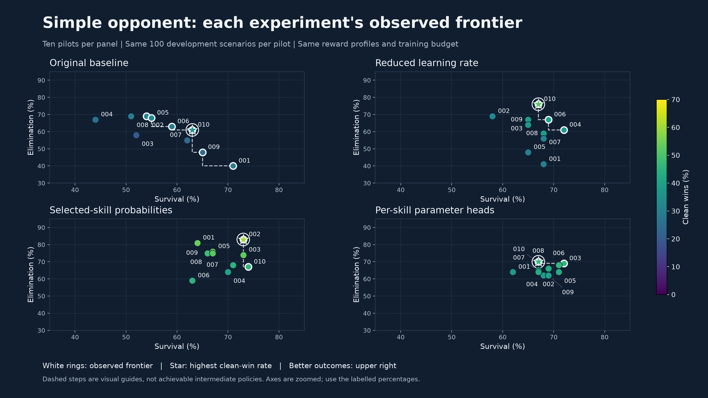
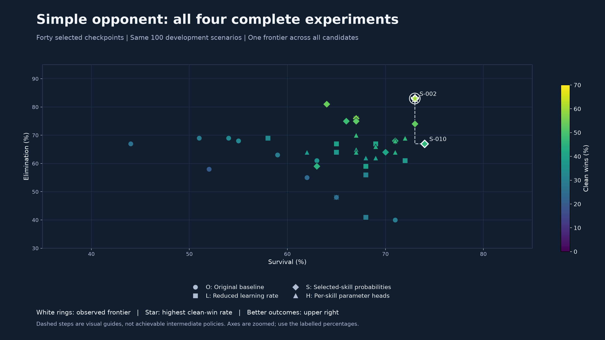
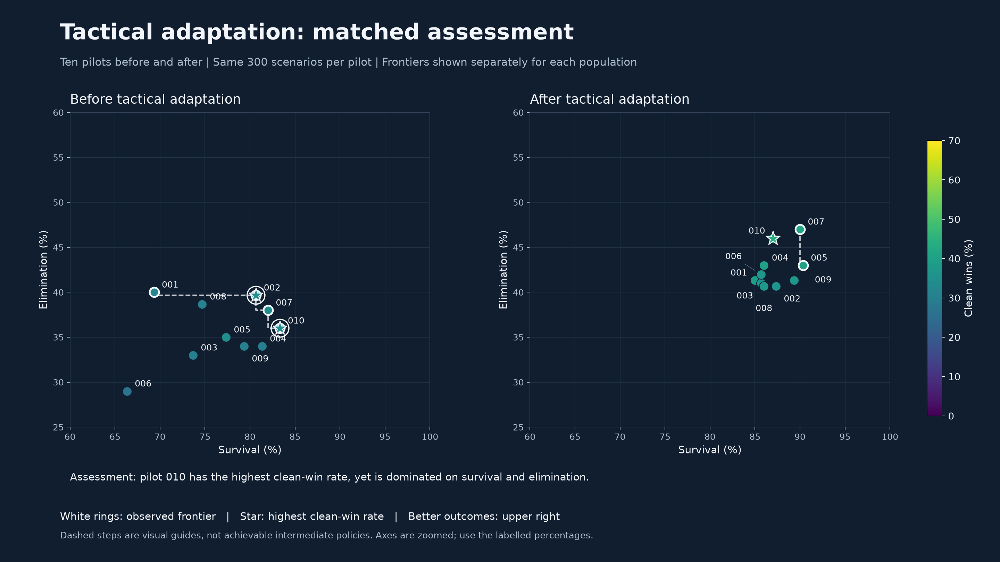
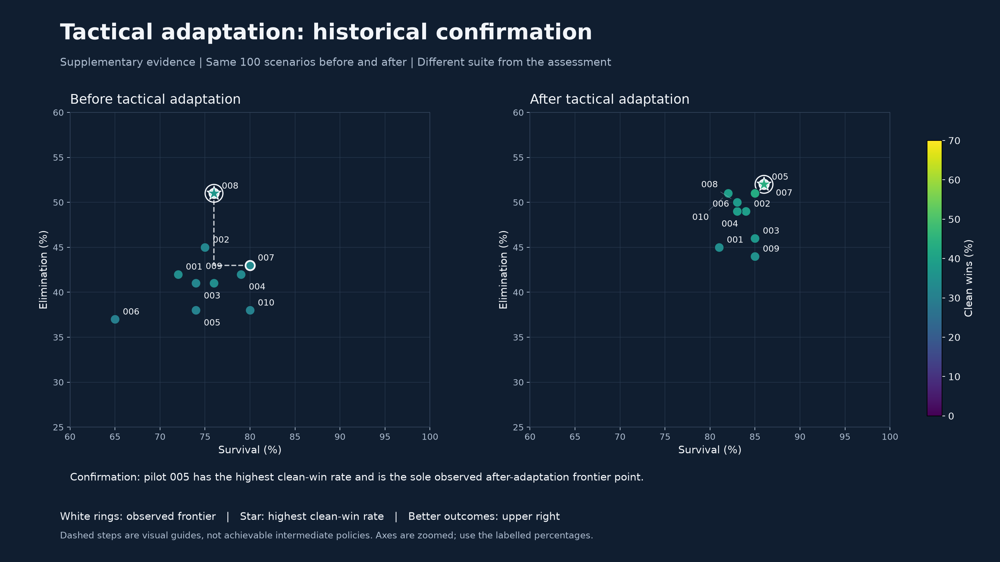
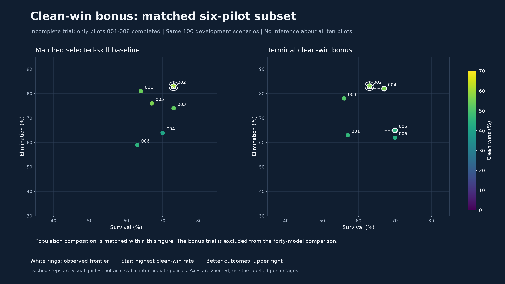

# Observed Pareto frontiers across pilot experiments

[Combined PDF](pareto_comparisons.pdf) · [Offline figure gallery](index.html)

These plots use saved selected-checkpoint outcomes. No training, model inference or simulation was performed.

## Interpretation

Each point is one pilot checkpoint. Both survival and elimination are maximised. A point is dominated when another candidate is at least as good on both measures and strictly better on at least one. Equal points are both retained. White rings identify the observed non-dominated set; dashed steps are visual guides only, not interpolated or achievable policies. Colour encodes clean wins and a star identifies the highest clean-win rate in each plotted candidate set. A star without a surrounding ring can be off the survival/elimination frontier.

This is an empirical frontier among tested checkpoints, not a proof of the global Pareto optimum. Reward coefficients and neural-network losses are not the plotted objectives. The four complete simple-opponent populations share the same reward profiles, training seed schedule, budget and 100 development cases. Tactical comparisons use matched before/after cases but are separate tasks and suites. The bonus trial includes only its six completed pilots and their matching baseline.

## Principal findings

- **Complete simple-opponent experiments:** selected-skill pilots 002 and 010 form the pooled observed frontier. Pilot 002 records 83% elimination, 73% survival and 60% clean wins; pilot 010 records 67%, 74% and 46%, respectively. The apparent survival benefit is only one percentage point.
- **Sensitivity to scenario sampling:** those two pilots remain on the pooled frontier in 99.0% and 32.0% of paired scenario resamples, respectively. This supports caution about interpreting pilot 010's small survival advantage as a stable specialisation. These frequencies are descriptive, not posterior probabilities or significance levels.
- **Tactical assessment:** adapted pilots 005 and 007 form the observed two-objective frontier. Their survival rates differ by only one case out of 300 (90.33% versus 90.00%). Adapted pilot 010 has the highest clean-win rate (43.33%) despite being off that frontier; adding clean wins as a third objective retains it.
- **Partial bonus experiment:** the matched selected-skill pilot 002 dominates all six completed bonus-trial pilots on the two plotted point estimates. The full ten-pilot bonus population was not completed.

## Figures

### Simple experiments

[PNG](simple_experiments.png) · [Vector PDF](simple_experiments.pdf)

Each frontier is relative to the ten pilots in that panel. Membership is not comparable as a score between panels.

### Simple comparison

[PNG](simple_comparison.png) · [Vector PDF](simple_comparison.pdf)

Only selected-skill pilots 002 and 010 are non-dominated among the forty observed points. This is a point-estimate comparison, not proof of statistical superiority.

### Tactical assessment

[PNG](tactical_assessment.png) · [Vector PDF](tactical_assessment.pdf)

Assessment: pilot 010 has the highest clean-win rate, yet is dominated on survival and elimination. Opponent conditions and scenario suites must not be pooled with simple-opponent results.

### Tactical confirmation

[PNG](tactical_confirmation.png) · [Vector PDF](tactical_confirmation.pdf)

Confirmation: pilot 005 has the highest clean-win rate and is the sole observed after-adaptation frontier point. Opponent conditions and scenario suites must not be pooled with simple-opponent results.

### Clean win bonus

[PNG](clean_win_bonus.png) · [Vector PDF](clean_win_bonus.pdf)

Partial experiment: the six completed pilots are compared only with their six matching baseline pilots.

## Numerical frontiers

All figures below are percentages. Frontier frequency is the percentage of 2,000 paired scenario resamples in which the point remains non-dominated within the stated candidate set. It is a sensitivity measure, not the probability that a pilot is truly optimal.

### simple/original

| Population | Pilot | Elimination | Survival | Clean win | Mutual destruction | Frontier frequency |
| --- | --- | ---: | ---: | ---: | ---: | ---: |
| Original baseline | 001 | 40.00% | 71.00% | 29.00% | 11.00% | 96.2% |
| Original baseline | 002 | 69.00% | 54.00% | 32.00% | 37.00% | 72.4% |
| Original baseline | 005 | 68.00% | 55.00% | 32.00% | 36.00% | 53.5% |
| Original baseline | 006 | 63.00% | 59.00% | 29.00% | 34.00% | 51.8% |
| Original baseline | 009 | 48.00% | 65.00% | 25.00% | 23.00% | 50.3% |
| Original baseline | 010 | 61.00% | 63.00% | 36.00% | 25.00% | 86.4% |

### simple/lower learning rate

| Population | Pilot | Elimination | Survival | Clean win | Mutual destruction | Frontier frequency |
| --- | --- | ---: | ---: | ---: | ---: | ---: |
| Reduced learning rate | 004 | 61.00% | 72.00% | 38.00% | 23.00% | 77.5% |
| Reduced learning rate | 006 | 67.00% | 69.00% | 41.00% | 26.00% | 65.0% |
| Reduced learning rate | 010 | 76.00% | 67.00% | 52.00% | 24.00% | 99.8% |

### simple/selected skill parameters

| Population | Pilot | Elimination | Survival | Clean win | Mutual destruction | Frontier frequency |
| --- | --- | ---: | ---: | ---: | ---: | ---: |
| Selected-skill probabilities | 002 | 83.00% | 73.00% | 60.00% | 23.00% | 99.0% |
| Selected-skill probabilities | 010 | 67.00% | 74.00% | 46.00% | 21.00% | 40.0% |

### simple/skill conditioned parameters

| Population | Pilot | Elimination | Survival | Clean win | Mutual destruction | Frontier frequency |
| --- | --- | ---: | ---: | ---: | ---: | ---: |
| Per-skill parameter heads | 003 | 69.00% | 72.00% | 46.00% | 23.00% | 85.4% |
| Per-skill parameter heads | 010 | 70.00% | 67.00% | 47.00% | 23.00% | 61.1% |

### simple/full comparison

| Population | Pilot | Elimination | Survival | Clean win | Mutual destruction | Frontier frequency |
| --- | --- | ---: | ---: | ---: | ---: | ---: |
| Selected-skill probabilities | 002 | 83.00% | 73.00% | 60.00% | 23.00% | 99.0% |
| Selected-skill probabilities | 010 | 67.00% | 74.00% | 46.00% | 21.00% | 32.0% |

### simple/bonus matched subset

| Population | Pilot | Elimination | Survival | Clean win | Mutual destruction | Frontier frequency |
| --- | --- | ---: | ---: | ---: | ---: | ---: |
| Selected-skill probabilities | 002 | 83.00% | 73.00% | 60.00% | 23.00% | 97.5% |

### tactical assessment/before

| Population | Pilot | Elimination | Survival | Clean win | Mutual destruction | Frontier frequency |
| --- | --- | ---: | ---: | ---: | ---: | ---: |
| Before tactical adaptation | 001 | 40.00% | 69.33% | 32.33% | 7.67% | 49.0% |
| Before tactical adaptation | 002 | 39.67% | 80.67% | 34.33% | 5.33% | 82.3% |
| Before tactical adaptation | 007 | 38.00% | 82.00% | 34.00% | 4.00% | 68.2% |
| Before tactical adaptation | 010 | 36.00% | 83.33% | 34.33% | 1.67% | 77.0% |

### tactical assessment/after

| Population | Pilot | Elimination | Survival | Clean win | Mutual destruction | Frontier frequency |
| --- | --- | ---: | ---: | ---: | ---: | ---: |
| After tactical adaptation | 005 | 43.00% | 90.33% | 39.67% | 3.33% | 52.8% |
| After tactical adaptation | 007 | 47.00% | 90.00% | 42.00% | 5.00% | 96.4% |

### tactical assessment/comparison

| Population | Pilot | Elimination | Survival | Clean win | Mutual destruction | Frontier frequency |
| --- | --- | ---: | ---: | ---: | ---: | ---: |
| After tactical adaptation | 005 | 43.00% | 90.33% | 39.67% | 3.33% | 52.8% |
| After tactical adaptation | 007 | 47.00% | 90.00% | 42.00% | 5.00% | 96.4% |

### tactical confirmation/before

| Population | Pilot | Elimination | Survival | Clean win | Mutual destruction | Frontier frequency |
| --- | --- | ---: | ---: | ---: | ---: | ---: |
| Before tactical adaptation | 007 | 43.00% | 80.00% | 33.00% | 10.00% | 69.5% |
| Before tactical adaptation | 008 | 51.00% | 76.00% | 37.00% | 14.00% | 99.0% |

### tactical confirmation/after

| Population | Pilot | Elimination | Survival | Clean win | Mutual destruction | Frontier frequency |
| --- | --- | ---: | ---: | ---: | ---: | ---: |
| After tactical adaptation | 005 | 52.00% | 86.00% | 44.00% | 8.00% | 85.2% |

### tactical confirmation/comparison

| Population | Pilot | Elimination | Survival | Clean win | Mutual destruction | Frontier frequency |
| --- | --- | ---: | ---: | ---: | ---: | ---: |
| After tactical adaptation | 005 | 52.00% | 86.00% | 44.00% | 8.00% | 85.1% |

## Validity and limitations

- **Useful for marginal outcome trade-offs.** The axes compare confirmed elimination and own survival. They are overlapping outcomes; neither is a reward total. Mutual destruction is reported separately and is not used to infer eliminations.
- **Clean wins remain a separate objective.** Marginal elimination and survival do not determine how often both occur together. On tactical assessment, adapted pilot 010 has the highest clean-win rate (43.33%) but is dominated on both plotted axes by pilot 007. Discarding every point off this two-dimensional frontier would therefore discard the best observed clean-win pilot. `data/frontiers.csv` also includes the non-dominated set when clean-win rate is added as a third maximisation objective; mutual destruction is still reported rather than included as a fourth objective.
- **Finite-scenario uncertainty.** Each suite uses the same cases for every pilot. There are 100 distinct scenario IDs in each simple or historical-confirmation suite, and 300 in tactical assessment, not ten times those counts. We resample scenario IDs jointly across every candidate and all outcomes. `data/points.csv` contains marginal percentile intervals; `data/frontiers.csv` contains frontier-membership frequencies. Small differences and point-estimate dominance are not statistical superiority claims, and marginal intervals are not a joint dominance test.
- **Conditional bootstrap interpretation.** Resampling measures sensitivity to this empirical mix of scenarios under an exchangeable-scenario assumption. It does not measure training-seed variation, uncertainty across aircraft or opponents, or selection bias from repeated development-benchmark inspection. Checkpoints remain fixed in every replicate.
- **Candidate-set dependence.** A pilot can be on its own experiment's frontier while being dominated by another experiment's pilot. A larger frontier is not automatically better. The pooled figure compares the forty complete simple-opponent checkpoints directly; the partial bonus trial is kept separate.
- **Previously inspected development evidence.** These reports are useful for interpretation and further development, not an untouched final test. A final evaluation should use common unused cases after experimental choices are fixed.

## Reproduction and evidence

View the PDF, PNG files or standalone HTML on a presentation PC without Python, model weights or Git LFS. The original slide pack remains unchanged.

Rebuild from packaged outcomes with `python scripts/build_pareto_presentation.py`. The optional `--collect` mode refreshes the package from local saved reports, verifies checkpoint identifiers and exact simple-scenario geometry, and cross-checks all complete populations against the published outcome tables. It never runs the simulator.

- [Episode outcome flags](data/episodes.csv)
- [Per-pilot rates and 95% marginal scenario-bootstrap intervals](data/points.csv)
- [Two- and three-objective frontier membership and resampling frequencies](data/frontiers.csv)
- [Analysis definitions](data/analysis.json)
- [Source hashes and collection scope](data/provenance.json)
- [Package checksums](checksums.json)
