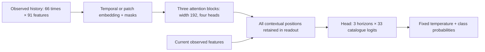

# Transformer challenge for skill catalogue forecasting (v5)

This study tests whether Transformers can match or exceed the best previously
tested forecaster. The reference is the **v4 fifteen-model ensemble**: half the
probability from twelve MLPs, half from three 60-second TCNs. Its existing
validation accuracies are 67.09%, 66.62% and 64.86% at +1/+2/+5 seconds. These are
empirical results, not proof that the architecture or its score is optimal.

The primary result is a **Transformer-only challenger**. A separately named
secondary result adds Transformers to the incumbent. An incumbent blend cannot
establish that Transformers alone replace the MLP/TCN system.

## Fixed task and comparison

The corpus, ten frozen trained pilots, tactical B01 viewpoint, scenario partitions,
33 labels, forecast origins, missing-target masks and exact +1/+2/+5-second
targets remain unchanged. Inputs retain the same 91 observation-derived features
and 26-token/20-second or 66-token/60-second histories. Current skill labels,
pilot identity and future tracks are not model inputs. No additional simulator
flights or RL-policy training are performed.

The primary metric is the equally weighted mean of the three horizon accuracies.
Internal comparisons then average equally across the two established partitions.
Probability quality and all-33-label macro-F1 remain reported. Matching is assessed
through measured differences and paired scenario intervals; an interval crossing
zero is not proof of equivalence. No noninferiority margin is introduced.

Every internal comparison uses the **full cached fifteen-model reference**:
each MLP has weight 1/24, and each TCN has weight 1/6. All cached internal models
were fitted only on that partition's 147 fit groups. The final incumbent weights,
trained on all 210 training groups, must never predict internal selection groups.

## Eight predeclared recipes

Each architecture is tested with both 20- and 60-second histories. Exact settings
are in [the registered configuration](../configs/training/skill_forecasting_transformer_search.json).

| Family | Attention/readout | Role |
|---|---|---|
| Existing pooled Transformer | Final and masked mean states plus current observation | Matched training/readout control |
| Temporal Transformer | All contextualized history positions retained in a flattened readout | Primary candidate |
| Patch Transformer | Older observations grouped in fives, recent observations in pairs, current token separate | Primary candidate |
| Transformer–MLP hybrid | Attention plus a parallel residual MLP over the full history | Explicitly separate hybrid |

The temporal and patch variants add fixed relative-time/gap coordinates and
validity flags to describe the existing nonuniform sampling. They use three
independently initialized pre-norm attention blocks, width 192 and four heads.
These are encoder-style Transformers trained from scratch on this corpus;
no pretrained language model or additional training dataset is used.
Their learned residual gains start at 0.1. The patch layouts contain nine or
seventeen tokens for the 20- or 60-second history respectively. No patch crosses
the older one-second/recent half-second sampling boundary.

Bidirectional attention is confined to observations already available at the
forecast origin. It does not access future target times. Invalid features are
removed before projection, invalid keys are excluded from attention, and hidden
padding is removed again after each block. Tests cover NaN padding, gradients,
batch independence, patch coverage and streaming checkpoint reload.

"Transformer-only" means every forecasting ensemble member is a Transformer.
Transformers still contain ordinary feed-forward sublayers and classification
heads; the architectural hybrid additionally has an independent full-history
MLP branch. Model counts and parameter budgets are reported rather than assumed
equal across families.

For a batch of `B` forecast origins, the 60-second input is `B × 66 × 91`:
batch, observation time, feature. Masks describe unavailable earlier history.
The temporal variant turns this into 66 contextual vectors of width 192; the
patch variant first combines nearby observations into 17 vectors of width 192.
Both keep the current observation available to the classification head. Each
network produces `B × 3 × 33` logits: one distribution over the same 33 labels
for each of the three horizons. These are direct forecasts; no true future label
or future observation is fed back as a decoder input.



The diagram describes the new pure temporal and patch variants. It does not
describe the pooled control's mean readout or the hybrid's parallel MLP branch.

Temporal patching is inspired by
[Nie et al., PatchTST](https://openreview.net/forum?id=Jbdc0vTOcol). Our model jointly
encodes the aircraft features and predicts catalogue classes; it is an adaptation,
not a reproduction of that paper's channel-independent regression experiments.

## Training and frozen selection

All new recipes use AdamW, batch size 1,024, a maximum of 60 epochs and four
warmup epochs from learning rate 0.00003 to 0.0003, followed by a fixed 56-epoch
cosine schedule back to 0.00003. Accuracy stopping has patience 10 and minimum
improvement 0.001. Temperature fitting uses stop groups only. Final refits use
the same fixed schedule prefix; no validation feedback changes their budgets.
The optional warmup leaves the older zero-warmup schedule exactly unchanged.

Earlier Transformer screens used different sampling and NLL stopping. The new
controls also receive sparse history, accuracy stopping and stop-only calibration,
so this study tests the training/readout choices as well as the model family.

1. Screen all eight recipes with seed 42 on partition 0. Rank their standalone
   mean accuracy, keeping single-model quality guards descriptive at this stage.
   Freeze the best two primary-family recipes and the best architectural hybrid.
2. Fit those three recipes with seeds 42/43/44 in both internal partitions.
   Each partition contains 147 fit, 21 stop and 42 selection groups, entirely
   inside the original training partition. Scaling uses fit groups only.
3. Primary recipes are each three-seed Transformer ensemble and the uniform
   six-model pair. Prefer the highest mean accuracy satisfying quality guards in
   both partitions: mean NLL no more than 0.02 worse, all-33 macro-F1 no more than
   0.01 worse and each horizon's accuracy no more than 0.003 worse than v4.
   If none qualify, freeze the highest-accuracy Transformer challenger and label
   its guard failures; evaluating a challenger is not automatic promotion.
4. Secondary recipes blend a confirmed family or the pure Transformer pair with
   the incumbent at new-model weights 0.25/0.5/0.75. They must improve mean accuracy
   and pass the quality guards in both partitions. Freeze the best such blend,
   or omit this secondary result if none qualify.
5. Freeze the primary and optional secondary together. New components use the
   median epoch and temperature across their six internal fits, then three fixed
   refits on all 210 training groups. Refit their union only once.
6. One validation invocation evaluates the already named outputs on identical
   origins. Do not choose another recipe from validation scores or tune afterward.
   Preserve every old result and unsuccessful new fit. The reserved test remains
   neither prepared nor evaluated.

The internal partitions overlap and have already guided development. The outer
validation has also been inspected previously. This is further development
evidence for new scenarios involving the same pilots, not an untouched final test
or an assessment of unseen-pilot generalization.

## Interpreting the initial internal screen

The following evidence comes from the six completed pure-Transformer screens,
**seed 42 on internal partition 0 only**. These are selection-group scores from
the original training partition, not final validation or test results. Accuracy
is the mean across +1/+2/+5 seconds; selection NLL includes stop-only temperature
calibration. The saved evidence is each run's `summary.json` and `history.csv`
under `improvement_v5_transformers/inner_0`.

| Family | 20s accuracy | 60s accuracy | 20s selection NLL | 60s selection NLL |
|---|---:|---:|---:|---:|
| Pooled Transformer | 56.11% | 55.41% | 1.540 | 1.542 |
| Temporal Transformer | 58.26% | 58.77% | 1.388 | 1.426 |
| Patch Transformer | 57.68% | 59.20% | 1.447 | 1.400 |

The full fifteen-member incumbent scores 60.53% accuracy and 1.217 NLL on these
same internal cases. Its ensemble size differs from each screening model, so
this is a reference comparison, not an architecture-only comparison at equal
model cost. These single-model results do not replace the multi-seed,
two-partition confirmation reported below.

Longer history helps temporal attention by 0.51 percentage points and patch
attention by 1.52 points here, while pooled attention loses 0.70 points. A
plausible explanation is that the flattened temporal readout preserves useful
position-specific maneuver information, while patches aggregate local movement
before attention. These are hypotheses, not a causal readout ablation: explicit
time/gap inputs, residual scaling, initialization and classification heads also
differ. All six share width, depth and training settings, but parameter counts
differ: pooled 1.58/1.59 million, temporal 2.54/4.02 million and patch 1.98/2.28
million for 20s/60s. This screen establishes no architecture optimum.

The incumbent already uses temporal context. Its MLPs flatten the complete
configured history, including validity masks, into a vector with a fixed slot
for each time and feature. A dense layer can therefore combine observations
across time; flattening does not discard their ordering. Its six-block TCN has
a 127-token receptive field, covering the complete 66-token, 60-second input.
Transformers change how that supplied history is combined; they do not uniquely
provide access to it.

The curves show signs of **probability overfitting**: minimum stopping NLL occurs
at epochs 5–11, whereas accuracy-selected checkpoints occur at epochs 31–55.
For example, the 60s pooled model's stopping NLL rises from 1.299 at epoch 9 to
1.683 at epoch 41 while stopping accuracy rises from 56.31% to 62.00% and the
training objective falls from 1.031 to 0.621. Better top-label predictions can
coexist with worse probability quality; accuracy-based stopping does not minimize
NLL. A lower score on different selection scenarios alone is not proof of overfit.

Keep three quantities distinct: **training objective** is label-smoothed cross
entropy measured with training dropout; **stopping NLL** is plain evaluation NLL
before temperature calibration; **selection NLL** is measured on separate groups
after calibration. Their absolute values are not directly interchangeable.
Temperatures of 1.47–1.54 soften these six models' confidence, but their calibrated
selection NLL still trails the incumbent in this screen. No protocol or stopping
rule is changed in response to these observations.

## Reproduction

Use a new, empty output directory for a new experiment. Existing registered runs
require their saved source snapshots; later live code intentionally fails their
source-hash guards.

```powershell
.venv\Scripts\python.exe scripts/transformer_skill_forecaster.py initialize
.venv\Scripts\python.exe scripts/transformer_skill_forecaster.py screen
.venv\Scripts\python.exe scripts/transformer_skill_forecaster.py confirm
.venv\Scripts\python.exe scripts/transformer_skill_forecaster.py refit
.venv\Scripts\python.exe scripts/transformer_skill_forecaster.py evaluate
```

## Results

### Internal confirmation and frozen recipes

All eight screens and fifteen additional confirmation fits completed. The
predeclared six-model pair (three patch plus three temporal Transformers) was
selected as the primary; it passed every quality guard in both partitions.
The separately frozen secondary is 75% of that Transformer ensemble plus 25%
of the preserved fifteen-model incumbent. The architectural hybrids were not
selected for either reported recipe.

| Internal partition | v4 mean accuracy | Six Transformers | Gain | Secondary blend | Gain |
|---|---:|---:|---:|---:|---:|
| 0 | 60.5334% | 61.0929% | +0.5594 pp | 61.4302% | +0.8968 pp |
| 1 | 63.6433% | 64.8144% | +1.1711 pp | 64.9124% | +1.2691 pp |
| Equal partition mean | 62.0883% | 62.9536% | +0.8653 pp | 63.1713% | +1.0829 pp |

The primary uses **18,908,886 parameters across six models**, versus 31,730,031
across fifteen in v4. The secondary retains both systems: 50,638,917 parameters
across twenty-one models. Parameter count is not a measured latency comparison.
Both outputs share the same six new final refits. Patch models receive 42 epochs
and temperature 1.5072423450; temporal models receive 28 epochs and temperature
1.4619287139, each with seeds 42/43/44. These budgets come from the registered
six-fit median rule and remain fixed during training on all 210 training groups.

### Development validation

The six frozen refits and single registered validation invocation completed.
**The Transformer-only model did not improve measured validation accuracy.**
The internal gain did not carry through to this development partition. The
separately frozen blend has a very small positive point estimate, with uncertainty
spanning both improvement and deterioration.

| Horizon | Preserved v4 | Six Transformers | Change | Frozen 75% Transformer blend | Change |
|---|---:|---:|---:|---:|---:|
| +1 s | 67.09% | 66.67% | -0.43 pp | 67.10% | +0.01 pp |
| +2 s | 66.62% | 66.47% | -0.15 pp | 66.73% | +0.11 pp |
| +5 s | 64.86% | 64.50% | -0.37 pp | 64.96% | +0.10 pp |
| Equal horizon mean | **66.19%** | **65.88%** | **-0.31 pp** | **66.26%** | **+0.07 pp** |

The paired 95% scenario interval for mean accuracy change is **[-1.18, +0.64]
percentage points** for the primary and **[-0.63, +0.84]** for the secondary.
Both cross zero; this establishes neither an accuracy improvement nor equivalence.
The 5,000 shared resamples preserve whole scenario groups and horizon dependence.
They are conditional on the frozen models and previously inspected development
data, without adjustment for the preceding model search.

| Mean across horizons | Preserved v4 | Six Transformers | Secondary blend |
|---|---:|---:|---:|
| All-33-label macro-F1 | 0.4024 | 0.3963 | 0.4006 |
| NLL (lower is better) | 1.0929 | 1.0618 | 1.0477 |

Probability quality and classification accuracy do not move together. Both new
recipes improve NLL, while the primary loses macro-F1 at all three horizons;
its +5-second macro-F1 falls from 0.3767 to 0.3639. The secondary improves
+1-second F1 but loses at +2/+5 seconds. The complete report also includes top-3
accuracy, Brier score and calibration error, with their regressions retained.

Pilot effects differ substantially. The primary improves four of ten pilot point
estimates at each horizon; the secondary improves four, six and six at +1/+2/+5
seconds. Pilots 001, 006, 008 and 009 regress at every horizon under both new
recipes. The largest primary loss is pilot 008 at +2 seconds: **-4.01 percentage
points**. These are correlated, exploratory comparisons; the full tables include
paired scenario intervals and support counts.

The result is a competitive smaller Transformer ensemble with better NLL, not a
demonstrated accuracy replacement. The six-model primary has about 40% fewer
parameters than v4, but a smaller count is not a latency benchmark. The 21-model
blend offers no established accuracy benefit for its additional model cost.
The v4 baseline and all earlier results remain intact. No recipe, weight,
checkpoint, epoch budget or temperature was retuned after this evaluation, and
the reserved test was not prepared or evaluated.

This bounded study does not establish an architecture optimum or show that
Transformers cannot improve further. The internal curves motivate a future,
separately registered comparison of stronger regularization and probability-aware
checkpoint selection using training partitions only. The present result must
remain part of the experiment history.

See the [six-page PDF and complete portable evidence](experiments/skill_forecasting_v5_transformers/README.md)
for every candidate, seed, pilot and skill comparison, timing and source provenance.
